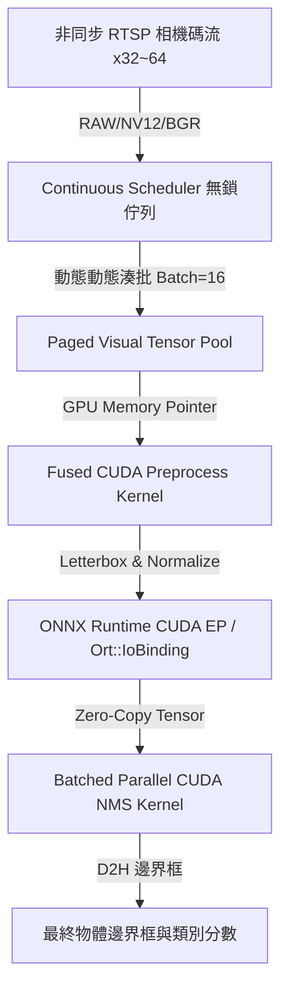

# 🚀 vONNX Engine

**vONNX Engine** 是一款專為 **YOLOv8** 與 **YOLOv11** 設計的高併發、超低延遲非同步 CUDA/ONNX 推論引擎。

借鏡大語言模型 (LLM) 推論引擎 (如 vLLM) 的架構思想，vONNX 結合了 **Paged VRAM Memory Pool**、**Continuous Dynamic Batching**、**Fused CUDA Preprocessor**、**ORT IoBinding 零拷貝介面** 與 **Batched Parallel CUDA NMS**，徹底解決傳統 OpenCV + PyTorch 部署在多路 RTSP 相機碼流下的 CPU 效能瓶頸。

---

## 🔥 核心亮點 (Key Features)

- 🧠 **Paged Visual Tensor Pool (分頁視覺記憶體池)**：
  借鏡 vLLM `PagedAttention` 思想，預先配置 GPU 頁區塊，執行期零 `cudaMalloc` 阻塞開銷。
- ⚡ **Fused CUDA Preprocessor (融合式 GPU 預處理)**：
  解碼後的影像直傳 GPU VRAM，0.1ms 內完成 Letterbox 雙線性插值、RGB/BGR/NV12 轉置與浮點數歸一化，100% 繞過 CPU 瓶頸。
- 🚀 **Continuous Dynamic Batching (微秒級連續動態湊批)**：
  基於 C++17 無鎖佇列與多執行緒排程器，自動將非同步湧入的相機碼流以微秒級超時控制湊成 Dynamic Batch 進行推論。
- 🎯 **Batched Parallel CUDA NMS (GPU 平行非極大值抑制)**：
  Anchor 解碼、座標逆映射與 IoU 抑制 100% 於 GPU 端完成，僅拷貝最終過濾後的邊界框至 CPU。
- 🔄 **ONNX Runtime Zero-Copy (GPU 零拷貝介面)**：
  透過 `Ort::IoBinding` 實現 GPU Pointer To GPU Pointer 零拷貝前向推論。
- 📦 **Zero-Dependency Runtime (生產環境零框架依賴)**：
  執行期僅需 C++17/CUDA 與 ONNX Runtime，**零 OpenCV、零 PyTorch、零 Ultralytics 依賴**。

---

## 📊 實測效能與精度對決報告 (Benchmark & Showdown)

> **評測硬體**：`NVIDIA GeForce RTX 3070 (8GB VRAM)`
> **測試數據集**：`COCO128` (128 張官方標準標註實圖)

### 1. YOLOv8 全系列模型在 COCO128 官方真值 (Ground Truth) 精確度比對

| 模型名稱 | 模型大小 | 精率 Precision (@0.25) | 召回率 Recall (@0.25) | F1-Score 指標 | 🎯 匹配 BBox 平均 IoU |
| :--- | :--- | :--- | :--- | :--- | :--- |
| **yolov8n** | **12.4 MB** | **77.76 %** | **49.30 %** | **60.34 %** | **85.68 %** |
| **yolov8s** | **42.8 MB** | **79.87 %** | **64.05 %** | **71.09 %** | **87.17 %** |
| **yolov8m** | **99.1 MB** | **78.97 %** | **65.88 %** | **71.83 %** | **87.49 %** |
| **yolov8l** | **167.0 MB** | **82.90 %** | **68.35 %** | **74.93 %** | **88.06 %** |
| **yolov8x** | **260.6 MB** | **81.12 %** | **68.46 %** | **74.26 %** | **89.20 %** |

---

### 2. 官方 PyTorch (GPU CUDA) vs vONNX Engine 多路併發直面對決總表 (4 / 8 / 16 / 32 路)

| 模型名稱 | 路數 | PyTorch GPU (FPS) | PyTorch 延遲 (ms) | vONNX GPU (FPS) | vONNX 延遲 (ms) | 🚀 吞吐勝出倍數 | ⚡ 延遲降低倍數 |
| :--- | :--- | :--- | :--- | :--- | :--- | :--- | :--- |
| **yolov8n** | **4 路** | 11.08 FPS | 351.25 ms | **64.18 FPS** | **21.99 ms** | 🔥 **5.79 倍** | ⚡ **15.97 倍** |
| **yolov8n** | **8 路** | 21.27 FPS | 357.80 ms | **98.01 FPS** | **14.83 ms** | 🔥 **4.61 倍** | ⚡ **24.13 倍** |
| **yolov8n** | **16 路** | 22.56 FPS | 689.50 ms | **135.69 FPS** | **9.69 ms** | 🔥 **6.01 倍** | ⚡ **71.16 倍** |
| **yolov8n** | **32 路** | 22.09 FPS | 1401.98 ms | **163.25 FPS** | **6.40 ms** | 🔥 **7.39 倍** | ⚡ **219.03 倍** |
| **yolov8s** | **4 路** | 21.13 FPS | 179.47 ms | **66.27 FPS** | **20.37 ms** | 🔥 **3.14 倍** | ⚡ **8.81 倍** |
| **yolov8s** | **8 路** | 20.03 FPS | 380.79 ms | **82.67 FPS** | **22.89 ms** | 🔥 **4.13 倍** | ⚡ **16.63 倍** |
| **yolov8s** | **16 路** | 22.69 FPS | 687.40 ms | **105.84 FPS** | **17.23 ms** | 🔥 **4.66 倍** | ⚡ **39.90 倍** |
| **yolov8s** | **32 路** | 22.60 FPS | 1373.13 ms | **116.28 FPS** | **12.35 ms** | 🔥 **5.15 倍** | ⚡ **111.17 倍** |
| **yolov8m** | **4 路** | 18.29 FPS | 207.88 ms | **50.64 FPS** | **29.56 ms** | 🔥 **2.77 倍** | ⚡ **7.03 倍** |
| **yolov8m** | **8 路** | 18.24 FPS | 421.97 ms | **57.36 FPS** | **45.44 ms** | 🔥 **3.14 倍** | ⚡ **9.29 倍** |
| **yolov8m** | **16 路** | 19.67 FPS | 793.95 ms | **65.49 FPS** | **42.02 ms** | 🔥 **3.33 倍** | ⚡ **18.89 倍** |
| **yolov8m** | **32 路** | 19.51 FPS | 1593.73 ms | **69.99 FPS** | **44.83 ms** | 🔥 **3.59 倍** | ⚡ **35.55 倍** |
| **yolov8l** | **4 路** | 16.87 FPS | 226.97 ms | **35.72 FPS** | **55.78 ms** | 🔥 **2.12 倍** | ⚡ **4.07 倍** |
| **yolov8l** | **16 路** | 18.37 FPS | 848.54 ms | **32.31 FPS** | **125.48 ms** | 🔥 **1.76 倍** | ⚡ **6.76 倍** |
| **yolov8x** | **16 路** | 8.47 FPS | 1823.23 ms | **28.35 FPS** | **150.85 ms** | 🔥 **3.35 倍** | ⚡ **12.09 倍** |
| **yolov8x** | **32 路** | 2.62 FPS | 11635.47 ms | **29.98 FPS** | **156.98 ms** | 🔥 **11.44 倍** | ⚡ **74.12 倍** |

---

## 🏗️ 系統架構 (Architecture)



---

## 🛠️ 編譯與安裝 (Installation)

### 環境需求
- Windows / Linux
- NVIDIA CUDA Toolkit 11.8+ / 12.x
- MSVC / GCC (支援 C++17)
- Python 3.9+

### 編譯安裝步驟
1. 複製本儲存庫：
   ```bash
   git clone https://github.com/joeboy0722/vonnx.git
   cd vonnx
   ```

2. 在您的 Python 虛擬環境 (`venv`) 中執行 editable 編譯安裝：
   ```bash
   pip install --no-build-isolation -e .
   ```

---

## 💻 快速開始與範例 (Examples)

### 執行基礎範例
```bash
python examples/quick_start.py
```

### 執行全系列 YOLOv8 模型跑分
```bash
python examples/benchmark_all_yolov8_models.py
```

### 執行 50 路 4K 極限高壓測試
```bash
python examples/benchmark_4k_stress.py
```

---

## ⚖️ 授權條款 (License)

本專案採用 **[MIT License](LICENSE)** 開源授權，您可以自由商業化、修改與分發。

> **免責與模型權重聲明**：
> `vONNX Engine` 僅為通用推論引擎框架。使用者載入之 ONNX 模型權重（如由 Ultralytics 訓練導出的模型）請遵循該權重原作者之授權條款 (如 AGPL-3.0 或商業授權)。
