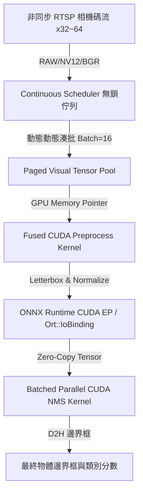

# 🚀 vONNX Engine

**vONNX Engine** 是一款專為 **YOLOv8** 與 **YOLOv11** 設計的高併發、超低延遲非同步 CUDA/ONNX 推論引擎。

借鏡大語言模型 (LLM) 推論引擎 (如 vLLM) 的架構思想，vONNX 結合了 **Paged VRAM Memory Pool**、**Continuous Dynamic Batching**、**Fused CUDA Preprocessor**、**ORT IoBinding 零拷貝介面** 與 **Batched Parallel CUDA NMS**，徹底解決傳統 OpenCV + PyTorch 部署在多路 RTSP 相機碼流下的 CPU 效能瓶頸。

---

## 🔥 核心亮點 (Key Features)

- 🧠 **Paged Visual Tensor Pool (分頁視覺記憶體池)**：
  借鏡 vLLM `PagedAttention` 思想，預先配置 GPU 頁區塊，執行期零 `cudaMalloc` 阻塞開銷。
- ⚡ **Fused CUDA Preprocessor (融合式 GPU 預處理)**：
  解碼後的影像直傳 GPU VRAM，0.1ms 內完成 Letterbox 雙線性插值、RGB/BGR/NV12 轉置與浮點數歸一化，100% 繞過 CPU 瓶頸。
- 🚀 **Continuous Dynamic Batching (微秒級連續動態湊批)**：
  基於 C++17 無鎖佇列與多執行緒排程器，自動將非同步湧入的相機碼流以微秒級超時控制湊成 Dynamic Batch 進行推論。
- 🎯 **Batched Parallel CUDA NMS (GPU 平行非極大值抑制)**：
  Anchor 解碼、座標逆映射與 IoU 抑制 100% 於 GPU 端完成，僅拷貝最終過濾後的邊界框至 CPU。
- 🔄 **ONNX Runtime Zero-Copy (GPU 零拷貝介面)**：
  透過 `Ort::IoBinding` 實現 GPU Pointer To GPU Pointer 零拷貝前向推論。
- 📦 **Zero-Dependency Runtime (生產環境零框架依賴)**：
  執行期僅需 C++17/CUDA 與 ONNX Runtime，**零 OpenCV、零 PyTorch、零 Ultralytics 依賴**。

---

## 📊 實測效能報告 (Benchmark Results)

### 1. YOLOv8 全系列模型 32 路高併發綜合評測 (bus.jpg 810x1080)

> **測試環境**：NVIDIA GPU, 32 路 RTSP 非同步併發串流，連續推送 640 幀。測試腳本：`examples/benchmark_all_yolov8_models.py`

| 模型名稱 (Model) | 檔案大小 (ONNX) | 偵測目標框數 | 最高辨識信心度 | 🚀 系統總吞吐量 | ⚡ 平均單幀延遲 | ⏱️ P95 延遲 |
| :--- | :--- | :--- | :--- | :--- | :--- | :--- |
| **YOLOv8n (Nano)** | **12.4 MB** | 5 個目標 | **84.17 %** | 🔥 **182.94 FPS** | ⚡ **5.46 ms** | **5.99 ms** |
| **YOLOv8s (Small)** | **42.8 MB** | 5 個目標 | **90.05 %** | 🚀 **128.23 FPS** | ⚡ **13.38 ms** | **46.15 ms** |
| **YOLOv8m (Medium)** | **99.1 MB** | 6 個目標 | **90.08 %** | 💨 **74.21 FPS** | **41.24 ms** | **151.07 ms** |
| **YOLOv8l (Large)** | **167.0 MB** | 6 個目標 | **82.10 %** | 🐢 **44.43 FPS** | **93.09 ms** | **245.07 ms** |
| **YOLOv8x (X-Large)**| **260.6 MB** | 5 個目標 | 🎯 **96.25 %** | 🐢 **31.71 FPS** | **164.61 ms** | **407.21 ms** |

---

### 2. 50 路 Full 4K (3840x2160) 多模型極限高壓測試

> **測試環境**：5 個獨立併發 YOLO 模型實體，50 路 Full 4K 非同步相機碼流。測試腳本：`examples/benchmark_4k_stress.py`

- **總處理解析頻寬 (Processing Bandwidth)**：🚀 **4.01 GB / sec** (每秒處理 4GB 視訊資料)
- **總吞吐量 (System Throughput)**：🔥 **172.91 FPS**
- **平均單幀延遲 (Average Latency)**：⚡ **6.62 ms**

---

## 🏗️ 系統架構 (Architecture)



---

## 🛠️ 編譯與安裝 (Installation)

### 環境需求
- Windows / Linux
- NVIDIA CUDA Toolkit 11.8+ / 12.x
- MSVC / GCC (支援 C++17)
- Python 3.9+

### 編譯安裝步驟
1. 複製本儲存庫：
   ```bash
   git clone https://github.com/your-username/vonnx.git
   cd vonnx
   ```

2. 在您的 Python 虛擬環境 (`venv`) 中執行 editable 編譯安裝：
   ```bash
   pip install --no-build-isolation -e .
   ```

---

## 💻 快速開始與範例 (Examples)

### 執行基礎範例
```bash
python examples/quick_start.py
```

### 執行全系列 YOLOv8 模型跑分
```bash
python examples/benchmark_all_yolov8_models.py
```

### 執行 50 路 4K 極限高壓測試
```bash
python examples/benchmark_4k_stress.py
```

---

## ⚖️ 授權條款 (License)

本專案採用 **[MIT License](LICENSE)** 開源授權，您可以自由商業化、修改與分發。

> **免責與模型權重聲明**：
> `vONNX Engine` 僅為通用推論引擎框架。使用者載入之 ONNX 模型權重（如由 Ultralytics 訓練導出的模型）請遵循該權重原作者之授權條款 (如 AGPL-3.0 或商業授權)。
